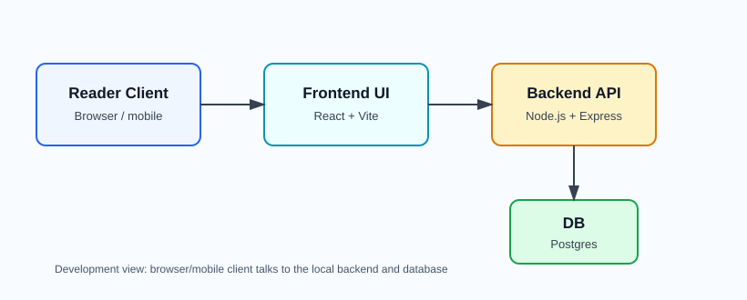
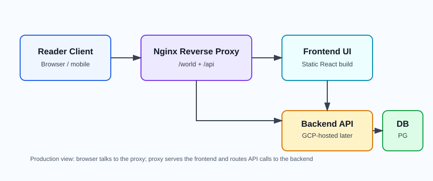

# Virtual Reading World — Architecture Diagram

This document shows two views of the architecture:

1. A development view for the current local setup.
2. A production view for the planned deployment on Google Cloud Platform (GCP).

## Development View

The development setup consists of the reader client, the frontend UI, the backend API, and the PostgreSQL database running locally or in a local development environment.

### Components

- **Reader Client**: The user interacts through a browser or a mobile page that renders the reading experience.
- **Frontend UI**: React + Vite app that renders the beach scene and handles user input.
- **Backend API**: Node.js + Express server exposes `/api/profile/:username` and profile update endpoints.
- **PostgreSQL Database**: Server-side data store that holds user profiles, reading corner state, and persistence data for the backend.

### Interfaces

- `Reader Client → Frontend UI`: Browser or mobile page load and user interaction over HTTP.
- `Reader Client → Backend API`: REST API calls under `/api`, including profile load and profile save, crossing the client/server boundary.
- `Backend API → Database`: SQL queries for profile creation, retrieval, and updates on the server-side database.

## Production View

The production setup will place the frontend behind a reverse proxy and route API traffic to the backend service, which will eventually run on GCP.

### Components

- **Reader Client**: The user interacts through a browser or a mobile page that renders the reading experience.
- **Nginx Reverse Proxy**: Serves the frontend static site from `/world` and proxies `/api` to the backend server.
- **Frontend UI**: Static React build served by the reverse proxy.
- **Backend API**: Server-side application hosted on GCP in the future.
- **PostgreSQL Database**: Server-side database used by the backend application.

### Interfaces

- `Reader Client → Nginx`: Static asset requests for `/world` and proxied API calls for `/api`.
- `Nginx → Frontend UI`: Delivery of the static frontend build.
- `Nginx → Backend API`: Routing of `/api` traffic to the backend service.
- `Backend API → Database`: SQL queries for profile creation, retrieval, and updates.
